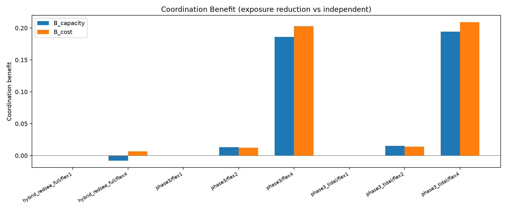

# BrineGuard Coast

[](https://github.com/mbessalle/brineguard-coast/actions/workflows/ci.yml)

[](LICENSE)

Several desalination plants discharge brine into the same stretch of coast. This project asks one question:
if the plants schedule production together instead of each for itself, how much less salinity exposure does
the coast receive at the same energy cost, and can that be predicted before running any optimisation?

It is a computational proof of concept built for the GPIW 2026 challenge (Track A): a synthetic screening and
coordination study, not a calibrated coastal-plume forecast and not a claim of regulatory compliance.

## Results



| | Result | Where |
|---|---|---|
| Headline benefit | Coordinated dispatch cuts the salinity-exposure proxy by **18.6-20.3%** (steady currents) and **19.4-20.9%** (tidal) against independently optimised plants, at no greater energy cost | synthetic three-plant benchmark with network flexibility |
| Scales with flexibility | 0.0% with no flexibility, 1.2-1.5% with ±10% turndown, 18.6-20.9% with network flexibility | same benchmark |
| Robust to forecast error | Positive on all 20 ensemble members with the coordinated schedule cost-capped: 14.5-26.0% and 16.1-27.9% against the two baselines | 20-member ensemble, 19 held out |
| Trade-off published | A +10.7% energy budget buys -27% exposure along the reported Pareto frontier | sensitivity study |
| **Null result, reported** | On real Red Sea bathymetry with assumed plants and currents the benefit is about zero (-0.8% to +0.7%) | hybrid real-coastline case |
| Screening principle | A bound computed from the transport kernel before any optimisation predicts both outcomes: 16.3% where 19-21% was measured, 4.3% where about zero was measured | both cases |

Every number above is taken from [`docs/CLAIMS.md`](docs/CLAIMS.md), which states each claim's exact conditions and
its evidence file, and lists what is **not** claimed (no ecological outcome, no site-specific accuracy, no
operational deployment).

## How it works

1. **Transport.** An analytic Gaussian-puff source-receptor kernel gives the salinity each plant causes at each
   receptor. It is linear by design, and an independent finite-difference solver cross-checks it on every domain.
2. **Dispatch.** A linear programme (Pyomo with the HiGHS solver) schedules production across plants under
   water-balance, turndown and storage limits, minimising exposure at a given energy cost.
3. **Evaluation.** Every schedule is re-simulated through the direct solver, so the optimiser never grades itself.
4. **Baselines.** Coordination is compared with plants optimised independently under two rules (capacity and cost).

## What makes the evidence trustworthy

- **Preregistered wording.** Claims were written down with their conditions before the final numbers were regenerated.
- **Frozen evidence.** [`evidence/2026-08-25/`](evidence/2026-08-25/) holds the outputs with a sha256 manifest;
  [`FREEZE.md`](FREEZE.md) records the freeze and the one audit-driven correction made after it.
- **Adversarial audit.** An independent audit recomputed the headline ratios from raw fields; its correction
  (a missing cost cap in the ensemble) lowered the reported numbers and is the version reported here.
- **Negative tests.** The suite includes tests that the checks themselves fail when they should.
- **A null result is a result.** The real-coastline case is reported as it came out.

## How it was built: a tiered multi-agent workflow

The repository was built by a small software factory, not by one chat session. The setup is in the repo:
[`sssf.config.yaml`](sssf.config.yaml) (routing), [`adws/`](adws/) (workflows and gates) and
[`tools/orca_dispatch.py`](tools/orca_dispatch.py) (worker dispatch through Orca).

| Tier | Role | Runs on |
|---|---|---|
| 1 | Planner and reviewer | the orchestrating Claude Code session |
| 1b | Independent reviewer, to avoid self-review | a different frontier model through OpenRouter |
| 2 | Builder, scout, documenter | workhorse models driven by the Pi agent harness, dispatched and supervised through Orca |
| 3 | Quality gates, tests, artifact and schema checks | plain code, zero tokens |

What keeps it honest:

- **Code checks, models build.** Every phase hands over a JSON envelope; [`adws/gates.py`](adws/gates.py) verifies that the
  files exist, the envelope parses, the diff matches what the worker claims it changed, and the test suite passes.
- **Workers cannot edit what grades them.** The gates, the frozen evidence, the claims document and the config are
  protected paths; a diff that touches them is rejected.
- **Bounded retries, then escalation.** A failing gate sends only the error output back to the builder for a
  limited number of attempts before the planner is involved.
- **Model-agnostic by design.** Roles map to backends in one config file, so a model is swapped by editing a line.

## Run it

```bash
uv venv .venv   # or: python3 -m venv .venv -- fails on systems without python3-venv installed
. .venv/bin/activate
uv pip install -e '.[test]'   # or: python -m pip install -e '.[test]'
python -m pytest           # 194 tests; the 22 that need third-party ocean data or generated runs are skipped with a reason
python -m brineguard run-first-slice --config configs/first_slice.yaml

# Phase 3-5 pipelines (see BUILD_PLAN.md):
python -m brineguard run-benchmark --config configs/phase3.yaml --config configs/phase3_tidal.yaml --run-id headline
python -m brineguard run-ensemble -c configs/phase3_tidal.yaml --members 20 --seed 20260825 --run-id ens
python -m brineguard run-sensitivity -c configs/phase3.yaml --run-id sens
make evidence          # frozen evidence bundle per FREEZE.md
make verify-evidence   # reproducibility gate
```

The last command needs only the saved YAML config and writes the complete standard output contract
under `runs/first-slice/`. Use `--run-id another-name` for subsequent immutable runs.

## Tests and data

`python -m pytest` runs 172 tests on a fresh clone. Another 22 need inputs that are deliberately not in git:
third-party ocean data under `data/registry/` (GEBCO bathymetry, CMEMS currents) and generated outputs under
`runs/`. [`tests/conftest.py`](tests/conftest.py) skips those with the missing path as the reason; with the data
in place they all run. CI runs the suite on every push.

## Layout

| Path | What it holds |
|---|---|
| `src/brineguard/transport/` | Source-receptor kernel and the finite-difference cross-check |
| `src/brineguard/dispatch/` | The linear-programme dispatch and its attestation |
| `src/brineguard/experiments/` | Benchmark, ensemble and sensitivity runners |
| `configs/` | Frozen scenario configurations |
| `evidence/` | Frozen outputs, figures and the manifest |
| `docs/CLAIMS.md` | Every claim, its conditions and its evidence |
| `tests/` | The test suite |
